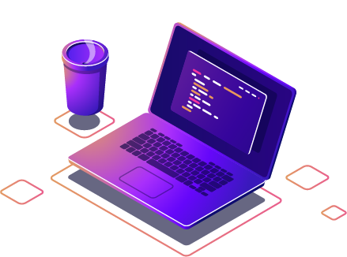

### Hi there 👋, I'm Everton

 
  I'm a <strong>Software Engineer</strong> and an <strong>Angular Specialist</strong>. 
  Graduated in System Development at Estácio de Sá. Passionate about creating clean, scalable, and highly performant web applications.

### 🚀 Main Tech Stack

  
  
  

### 🛠️ Other Skills & Tools

  <strong>Frontend:</strong> HTML5, CSS3  
  <strong>Backend & DB:</strong> Node.js, Java, SQL Oracle  
  <strong>Tools:</strong> Visual Studio Code, Figma, Git, GitHub

### 💌 Let's Connect

  If you want to carry out a project with me (or make small talk), don't hesitate to send me a message: ⤵️

  

  

