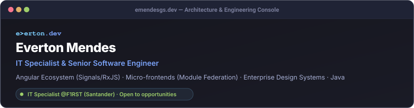

  

  
  
  
  

---

### 🛠️ Architecture & Core Stack

**Frontend & UI Architecture**  
<kbd> Angular (Signals / Standalone)</kbd> <kbd> TypeScript</kbd> <kbd> Micro-frontends (Module Fed.)</kbd> <kbd> Enterprise Design Systems</kbd> <kbd> RxJS</kbd> <kbd> Ionic & WebViews</kbd>

**Backend & Distributed Systems**  
<kbd> Java (Spring Boot / Microservices)</kbd> <kbd> Node.js</kbd> <kbd> NestJS</kbd> <kbd> PostgreSQL</kbd> <kbd> Prisma</kbd>

**DevOps, Cloud & Quality**  
<kbd> AWS Cloud</kbd> <kbd> Docker</kbd> <kbd> Jest & Cypress</kbd>
